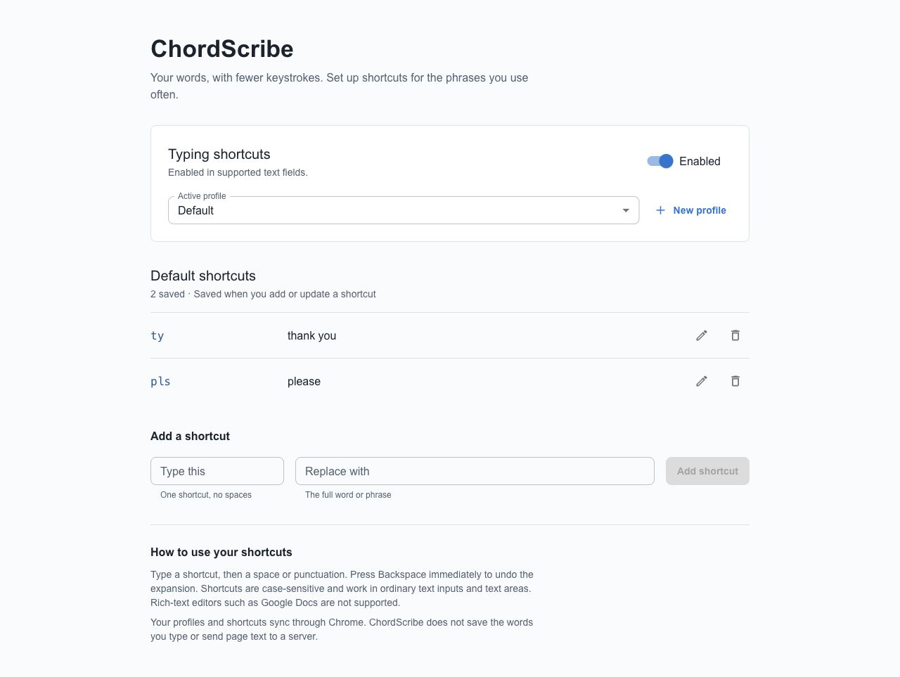

# ChordScribe

**Keyboard layout optimization and practical typing shortcuts.**

ChordScribe explores two ways to make everyday typing more efficient: evolving
keyboard layouts against a text corpus, and expanding short, explicit shortcuts
into the words and phrases you use often.

Built by **Vibbodh Somani, Yamahn Tanjour, and Sarah Ali** as a Jugend forscht
research project. In real testing with **15 participants**, the chord-based typing
test recorded an **18% average improvement**. See [the study notes](docs/RESEARCH.md)
for the method, results, and limitations.



## Try it locally

You need **Node.js 24 or newer** and npm. From a fresh clone:

```bash
git clone https://github.com/iambodha/ChordScribe.git
cd ChordScribe
npm ci
npm run check
npm run preview
```

Open **http://127.0.0.1:4173**. Type `ty` followed by a space to get `thank you`;
press Backspace immediately to undo. Open **Manage shortcuts** to create profiles,
add or edit phrases, and pause expansion.

The playground uses the same expansion and settings logic as the extension, with
a local browser-storage adapter. It is a development preview, not a substitute
for checking the installed Chrome extension.

## Install the Chrome extension

```bash
npm run build
```

1. Open `chrome://extensions` in Chrome 120 or newer.
2. Enable **Developer mode**, choose **Load unpacked**, and select
   **`Chording Chrome Extension/dist`**.
3. Open a normal webpage, or refresh one already open.
4. Use the toolbar popup to select a profile, pause shortcuts, or open settings.

Shortcuts are case-sensitive. A space or supported punctuation
(`.`, `,`, `!`, `?`, `;`, `:`) completes the shortcut.
Ordinary text/search inputs and text areas are supported. Passwords, read-only
fields, autocomplete fields marked for credentials/payment codes, and fields
opting out with `data-chordscribe="off"` are skipped. Rich-text editors
(including Google Docs), browser-internal pages, and iframe fields are not
supported in this version. Pasted text and IME composition do not trigger expansion.

Profiles and shortcuts use Chrome sync storage. The extension does not save
typing history or send page text to a server. Chrome's own sync behavior applies
to your saved shortcut phrases. See [privacy and permissions](docs/PRIVACY.md).

To create a distributable ZIP:

```bash
npm run package
```

The result is `artifacts/chordscribe-extension-0.2.0.zip`. Extract it before using
**Load unpacked**. This is a development build; it is not a Chrome Web Store listing.

## Compare keyboard layouts

```bash
npm run benchmark
# Use your own UTF-8 corpus:
node scripts/benchmark.cjs --corpus /path/to/corpus.txt --effort 100000
# Machine-readable output:
node scripts/benchmark.cjs --json
```

The comparison runs QWERTY, Dvorak, Colemak, and Workman through the same effort
model. It records the corpus hash, effort budget, and results.
[The bundled example benchmark](docs/BENCHMARK.md) explains the units and limits.

To run the genetic search in an interactive terminal:

```bash
npm run layout
```

By default it uses `examples/corpus.txt`. Set `CHORDSCRIBE_CORPUS` to a UTF-8
file or a directory of `.txt`/`.md` files to use your own material. The search
is stochastic; the fixed-layout benchmark is deterministic.

The layout model measures estimated effort and travel, not human typing speed,
comfort, or medical benefit. The participant result above concerns the historical
shortcut test, not the layout simulator or this refreshed extension build.

## How the project fits together

| Area | Purpose | Status |
|---|---|---|
| `Chording Chrome Extension/` | Manifest V3 extension, profiles, explicit text expansion, one-step undo | Runnable build and tests |
| `Layout Optimization/` | Genetic search and layout scoring | Runnable sample corpus and regression tests |
| `scripts/` | Benchmark, local playground, ZIP packaging | Supported developer entry points |
| `Chording/Fitness/` | Word-level scoring experiments | Historical research scripts |
| `Chording/*.py` | Tokenization, chord generation, desktop prototype | Historical; see limitations below |
| `Dataset/` | Language/programming corpus acquisition | Optional research preparation |

The Python desktop prototype imports `platform_specific`, which is absent from
this repository; it is not currently a complete installable desktop application.
The data scripts need external datasets and additional Python packages. They are
retained as research history rather than included in the supported quick start.

## Development

```bash
npm run typecheck  # Extension TypeScript
npm test           # Extension behavior + legacy layout suite
npm run check      # Typecheck, tests, production build
npm run package    # Production build + ZIP
```

CI repeats these checks on pull requests and uploads the extension ZIP and
benchmark JSON as build artifacts. [Contributing](CONTRIBUTING.md) covers
the local workflow and browser verification.

The current release focuses on explicit, user-defined shortcuts. The previous
experimental word-form rewrites and typing-history storage are no longer part of
the supported path. Existing profiles and the enabled/paused setting are preserved
when the extension updates.

## Research and credits

Read [the research notes](docs/RESEARCH.md), [architecture](docs/ARCHITECTURE.md),
and [release notes](CHANGELOG.md). The inherited layout engine and physical
effort model build on the keyboard-genetics / keyboard-analytics work referenced
in the original source. See [third-party credits](THIRD_PARTY_NOTICES.md).

Contributions are welcome: report a reproducible issue, improve a measured
workflow, or add a regression test. Project code is covered by the [MIT license](LICENSE),
subject to the notices for third-party material.
